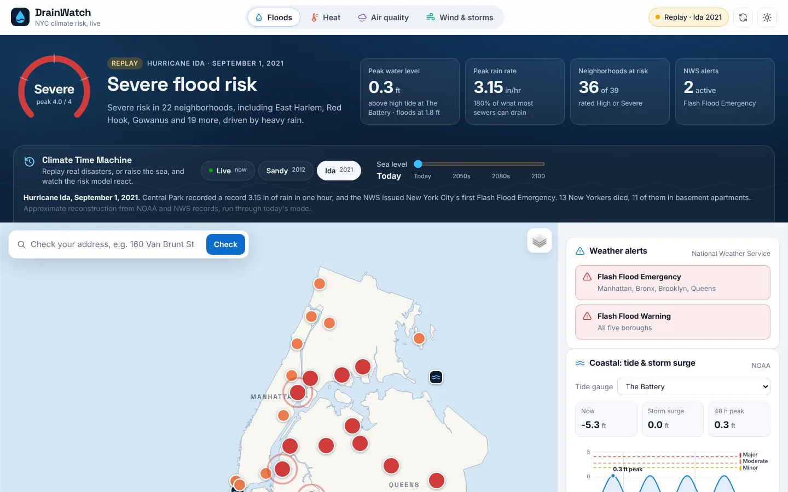
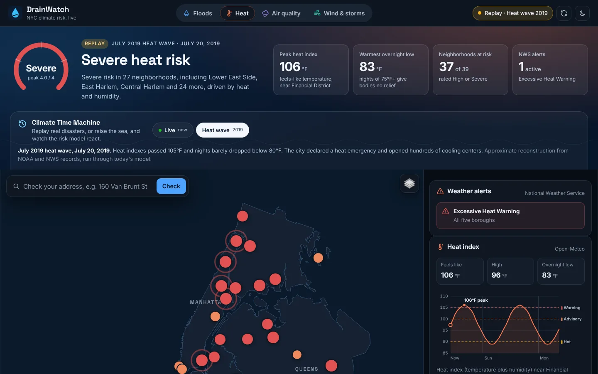
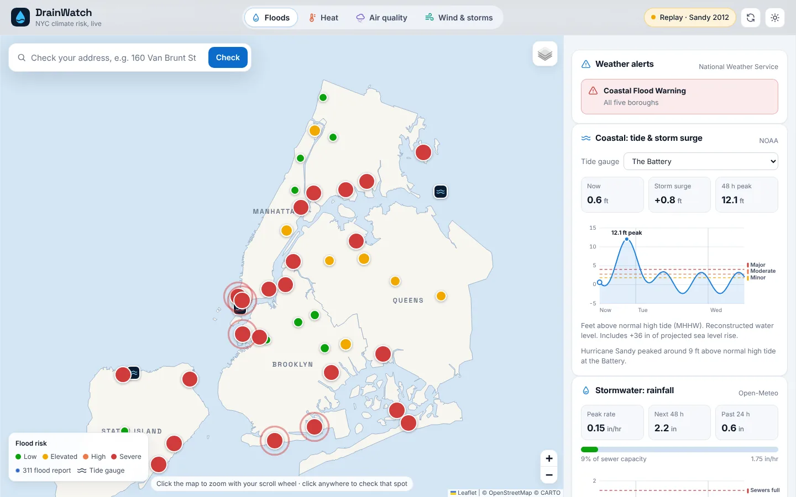
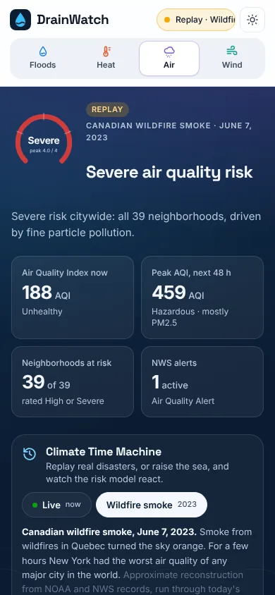

# DrainWatch NYC

**Live climate risk for every New York City neighborhood: floods, heat, air quality, wind and storms.**

DrainWatch turns free public data from NOAA, the National Weather Service, Open-Meteo, NYC 311 and FEMA into a
plain-language risk level (Low, Elevated, High or Severe) for 39 neighborhoods and any NYC address. Its
**Climate Time Machine** replays real disasters (Hurricane Sandy, Hurricane Ida, the 2019 heat wave and the 2023
wildfire smoke) through the same model, and raises the sea to show what climate change does to an ordinary high tide.



## Why it exists

Climate change is already hitting New York, but it does not hit every block the same way. Ida's record rainfall
drowned people in basement apartments in inland Queens, far from the coast. Sandy's storm surge flooded the
Rockaways and Lower Manhattan. Heat kills more New Yorkers than any other kind of weather, mostly in neighborhoods
with fewer trees and less air conditioning. The data to see this coming is public, but it is spread across a
dozen agencies and written for experts. DrainWatch puts it in one place, in plain English, for the block you live on.

## What it does

| Feature | What you get |
| --- | --- |
| **Four hazard tabs** | Floods, Heat, Air quality, and Wind & storms. Each has a citywide risk gauge, key numbers, NWS alerts, a 48-hour chart and a ranked list of neighborhoods. |
| **Risk map** | 39 neighborhoods colored by risk level, the worst ones pulsing. The flood tab adds tide gauges, 311 street-flooding reports and FEMA flood zones. |
| **Address report card** | Search any address (or click the map) for one card covering all four hazards, using the FEMA flood zone and a year of 311 flooding reports for that exact spot. |
| **Climate Time Machine** | Replay Hurricane Sandy (2012), Hurricane Ida (2021), the July 2019 heat wave, Tropical Storm Isaias (2020) and the June 2023 wildfire smoke. Drag the sea level slider to the 2050s, 2080s or 2100 to see today's high tides turn into floods. |
| **Be ready** | A preparedness checklist for each hazard (evacuation zones, basement apartments, cooling, N95s, power outages), with progress saved in your browser. |
| **How it works** | Every rule of the risk model, the data sources and their live status, on the page. |

Every view has its own link, so you can share one directly: `#floods/ida`, `#heat/heat-2019` or `#floods/live/2080s`.

<p>
  
  
</p>
<p align="center"></p>

## Run it

It's plain **HTML, CSS and JavaScript**: no build step, no framework, no API keys. You only need Python 3, which
most Macs and Linux machines already have.

```bash
cd DrainWatch
python3 -m http.server 8000
```

Open <http://localhost:8000>. Press `Ctrl+C` to stop the server.

> Why not double-click `index.html`? The JavaScript uses ES modules (`import`), and browsers block those for files
> opened straight from disk. The small Python server fixes that.

No internet? The page says the live feeds are offline and offers a historical replay, which runs entirely from
local code. That makes it a reliable demo.

## Tests

With [Node.js](https://nodejs.org/) 18 or newer:

```bash
node --test
```

The suite covers the four risk models (checked against the NWS heat index chart, the EPA AQI breakpoints, and NWS
wind and flood criteria), every historical replay, sea level rise, and the data layer (with a fake `fetch`, so no
network is needed). GitHub Actions runs it on every push.

## How the risk level is calculated

Each hazard follows the same pattern, so the model is easy to explain and to test:

> **score (0–4) = how bad conditions will get (hazard 0–4) × how exposed the neighborhood is, plus NWS alerts**

| Score | Level |
| --- | --- |
| 0–1 | Low |
| 1–2 | Elevated |
| 2–3 | High |
| 3–4 | Severe |

| Hazard | Hazard from live data | Neighborhood exposure |
| --- | --- | --- |
| **Floods** ([`js/risk.js`](js/risk.js)) | Peak water level (NOAA tide + current storm surge) vs. NOAA's minor/moderate/major flood thresholds. Peak hourly rain vs. NYC's ~1.75 in/hr sewer capacity. | Coastal and stormwater exposure (0–3) from FEMA flood maps, NYC DEP stormwater maps, and Sandy and Ida damage. Address checks use the real FEMA zone and 311 history. |
| **Heat** ([`js/heat-risk.js`](js/heat-risk.js)) | Peak NWS heat index (Rothfusz regression) at 80/90/100/105°F, plus warm nights (lows of 75°F+). | NYC Heat Vulnerability Index (1–5): surface temperature, green space, air conditioning, income and structural racism. |
| **Air quality** ([`js/air-risk.js`](js/air-risk.js)) | Peak US AQI over 48 h (EPA categories), with PM2.5 and ozone. | Neighborhoods with a heavy asthma burden move up half a step once the air is no longer Good. |
| **Wind & storms** ([`js/storm-risk.js`](js/storm-risk.js)) | Peak gust vs. NWS Wind Advisory (46 mph), High Wind Warning (58 mph) and hurricane force (74 mph), plus thunderstorms. | Open shoreline ×1.2, waterfront or tree-lined ×1.0, sheltered ×0.8. |

Neighborhood ratings are simplified summaries of public data, not official designations; see the comments in
[`js/config.js`](js/config.js). **DrainWatch is an educational tool, not an official warning system.** In an
emergency, follow [Notify NYC](https://www.nyc.gov/notifynyc) and the [National Weather Service](https://www.weather.gov/okx/).

### About the replays

Replays rebuild each storm's conditions as hourly data shaped exactly like the live APIs return, then run them
through the same summaries and risk models ([`js/scenarios.js`](js/scenarios.js)). The numbers are approximate
reconstructions from NOAA tide gauge records, NWS storm summaries and EPA AirNow reports, labeled as such on the page.
Sea level rise uses the middle of the NYC Panel on Climate Change (NPCC 2019) likely range for each period.

## Data sources

**You don't need any API keys.** Every source is free and public:

| Source | What it gives us | Key needed? |
| --- | --- | --- |
| [NOAA Tides & Currents](https://api.tidesandcurrents.noaa.gov/api/prod/) | Water levels, tide predictions | No |
| [Open-Meteo](https://open-meteo.com/) | Hourly rain, temperature, humidity, wind | No (free for non-commercial use) |
| [Open-Meteo Air Quality](https://open-meteo.com/en/docs/air-quality-api) | US AQI, PM2.5, ozone | No |
| [National Weather Service](https://www.weather.gov/documentation/services-web-api) | Active alerts | No |
| [NYC Open Data: 311](https://data.cityofnewyork.us/Social-Services/311-Service-Requests-from-2010-to-Present/erm2-nwe9) | Street flooding and sewer backup reports | Optional "app token" |
| [NYC GeoSearch](https://geosearch.planninglabs.nyc/) | Address lookup | No |
| [FEMA National Flood Hazard Layer](https://hazards.fema.gov/femaportal/wps/portal/NFHLWMS) | Flood zones | No |
| [NYC Open Data](https://data.cityofnewyork.us/): borough boundaries | Map outlines (NYC Department of City Planning, simplified, in `data/`) | No |

### A quick primer on API keys

An **API** is a web address that returns data instead of a web page. Some APIs ask for an **API key**, a
password-like string, so they know who is calling. Two rules of thumb:

1. **Secret keys must never go in front-end code** (HTML/JS/CSS). Anyone can open the page and read them. They belong on a server.
2. **Some "keys" are designed to be public**, like NYC Open Data's app token. It only identifies your app for rate
   limits, so it's fine in `js/config.js`.

Without a token, NYC Open Data allows a limited number of requests per hour from each visitor, which is plenty for
personal use. To add one, create a free account at <https://data.cityofnewyork.us/signup>, go to **Developer
Settings → Create New App Token**, and paste the **App Token** (not the secret) into `js/config.js`:

```js
export const NYC_OPEN_DATA_APP_TOKEN = 'paste-your-token-here';
```

## Project layout

```
index.html              page structure, icons and story sections
css/style.css           design system: tokens, light + dark themes, responsive layout
js/app.js               state, live loading, URL routing, rendering, address search
js/config.js            39 neighborhoods with exposure ratings, tide stations, reference numbers
js/risk.js              flood model + shared helpers            ┐
js/heat-risk.js         heat index and heat model               │ pure functions,
js/air-risk.js          AQI and air quality model               │ no network or DOM,
js/storm-risk.js        wind and storm model                    │ fully tested
js/hazards.js           runs a model across the city, builds headline + KPIs
js/scenarios.js         Climate Time Machine: replays + sea level rise  ┘
js/data.js              calls each public API and summarizes the response
js/map.js               Leaflet map, borough outlines, pins and layers
js/panels.js            sidebar cards, popups and the address report card
js/charts.js            SVG gauge, hourly charts with hover, sea level chart
js/tide-chart.js        tide chart with NOAA flood thresholds
js/story.js             sea level section, preparedness checklist, methodology
js/content.js           checklist and methodology text
js/ui.js                small HTML helpers
data/nyc-boroughs.geojson  simplified borough outlines (NYC Department of City Planning)
vendor/leaflet/         Leaflet 1.9.4, bundled so the map never depends on a CDN
tests/                  node --test suites
```

## Accessibility

- Every risk level is shown as a word as well as a color, and the map has a full text equivalent (the ranked list).
- Hazard tabs, replay picker and checklist tabs work with the arrow keys; a skip link jumps to the dashboard.
- Charts have text summaries and a crosshair tooltip. The sea level chart has a data table for screen readers.
- Light and dark themes (following your system setting, with a toggle), reduced-motion support, and layouts down to 360 px wide.

## Ideas for next steps

- Use NYC's official Stormwater Flood Map polygons instead of neighborhood ratings.
- A small Python backend to cache API responses and send opt-in text alerts for a saved address.
- Translations into Spanish, Chinese, Russian, Bengali and other languages New Yorkers speak at home.
- Add more historical replays, such as Hurricane Irene (2011) and the August 2023 Brooklyn flash floods.
