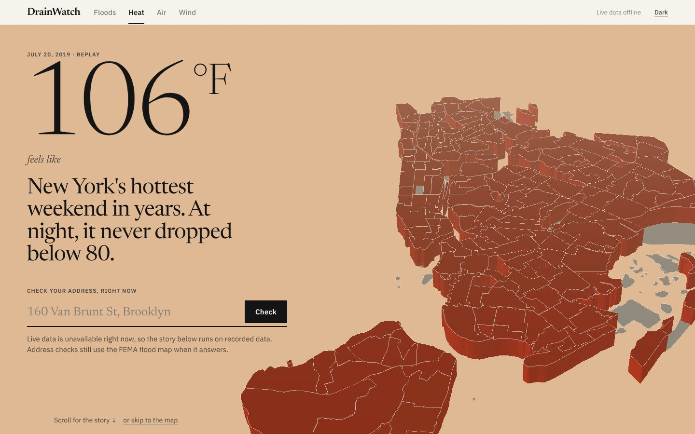
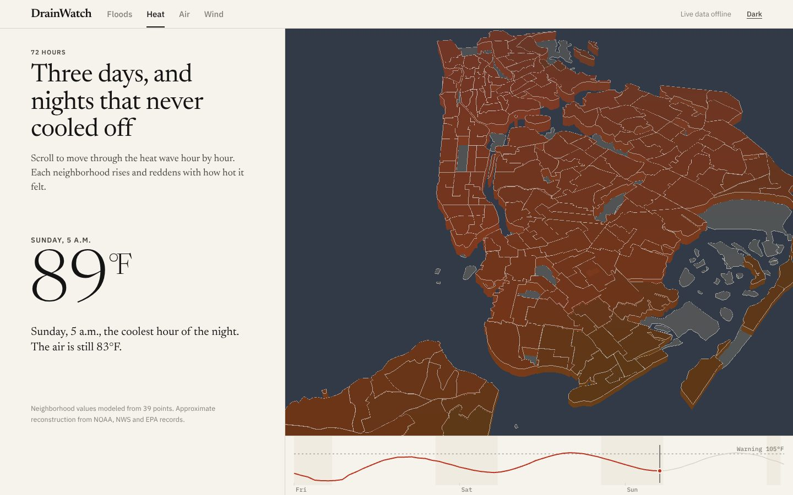
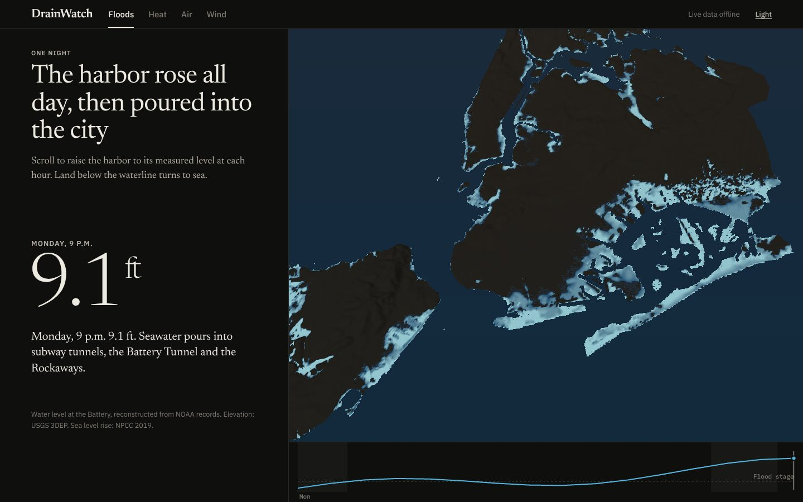
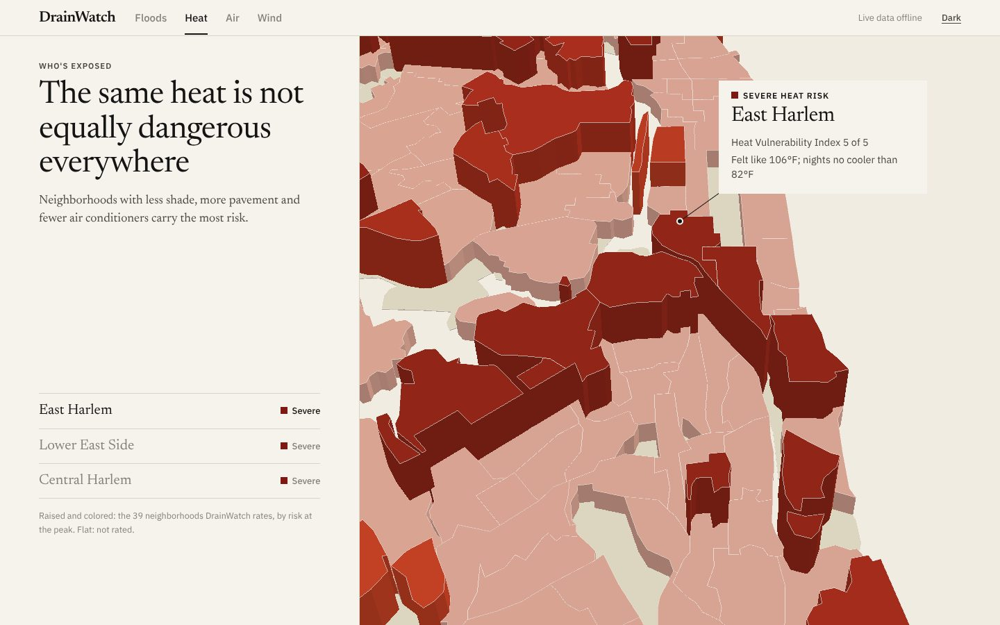
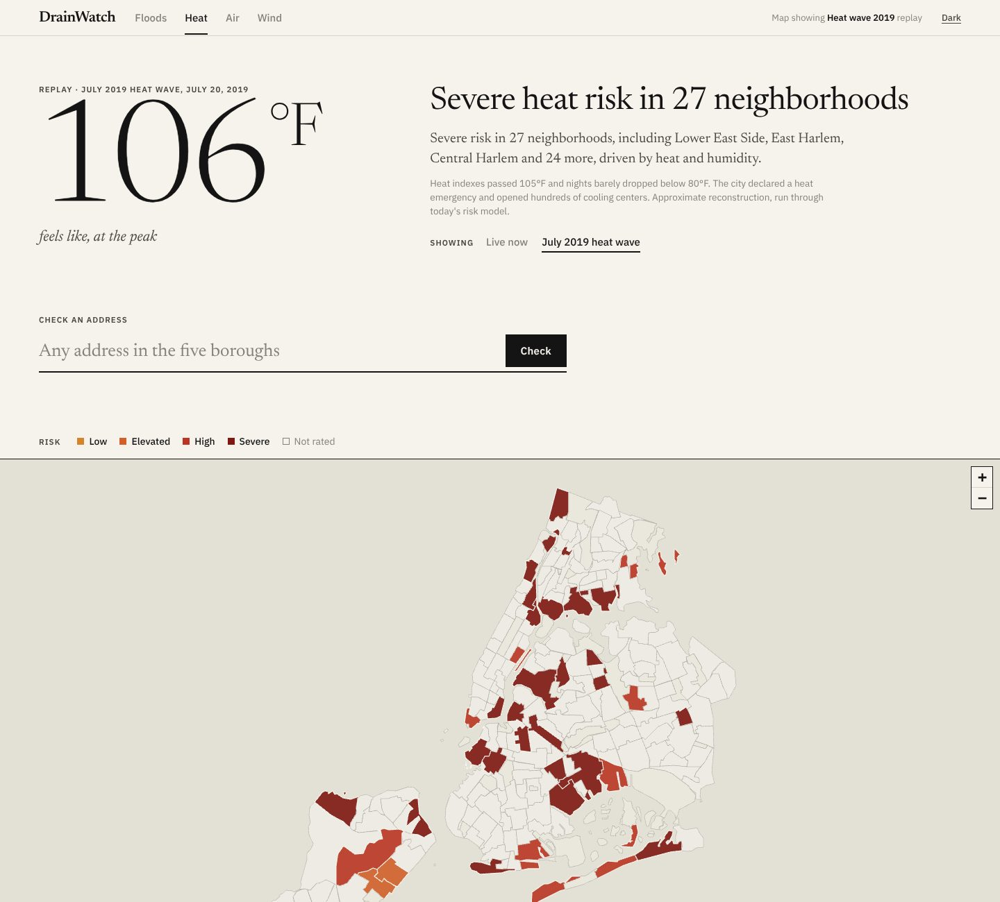

# DrainWatch

**How climate risk hits New York City, block by block, and what it looks like at your address right now.**

DrainWatch tells the story of four real New York disasters in a scroll-driven 3D city: the July 2019 heat
wave, Hurricane Sandy, the 2023 wildfire smoke and Tropical Storm Isaias. Then it hands you a fast, live app:
type any address and get its flood, heat, air quality and wind risk for the next 48 hours, from free public data.



## Why it exists

Climate change is already here, but it does not hit every block the same way. Ida's record rain drowned people in
basement apartments in inland Queens. Sandy's surge flooded the Rockaways and Lower Manhattan. Heat kills more New
Yorkers than any other weather, mostly in neighborhoods with fewer trees and less air conditioning. The data to see
this is public, but it is scattered across a dozen agencies and written for experts. DrainWatch puts it in one place,
in plain English, for the block you live on.

## What's on the page

1. **The headline.** One big number from a real event (106°F feels-like during the 2019 heat wave), and the address
   search right under it. If any hazard is High or Severe *today*, the page leads with live conditions instead.
2. **The timeline** (pinned, scroll to scrub). Scrolling moves hour by hour through the event. Neighborhoods rise and
   recolor with the heat index, AQI or wind gusts; the sun moves to its real position for each hour, so the sky goes
   dark while the city stays red. In the flood story the harbor rises over USGS elevation data to the water level
   NOAA measured, then rises again by the sea level projected for the 2080s.
3. **Who's exposed** (pinned, three steps). The camera visits the hardest-hit neighborhoods. Each stop is anchored to
   its place in 3D, with its risk level and the reasons, such as heat vulnerability or asthma burden.
4. **The app.** No scroll effects from here on: a full-width map of the city's neighborhoods, an address report card for
   all four hazards, NWS alerts, 48-hour forecast charts, a ranked table, sea level rise scenarios, and a
   preparedness checklist.

| Hazard | Story | 3D shows |
| --- | --- | --- |
| Heat | July 2019 heat wave, 72 hours | Heat index per neighborhood, sun and sky for each hour |
| Floods | Hurricane Sandy, October 29, 2012 | The harbor rising over real terrain; flooded land shaded by depth |
| Air quality | Canadian wildfire smoke, June 7, 2023 | AQI per neighborhood; haze thickens with the smoke |
| Wind & storms | Tropical Storm Isaias, August 4, 2020 | Peak gusts per neighborhood |

<p>
  
  
</p>
<p>
  
  
</p>

## Run it

Plain **HTML, CSS and JavaScript**: no build step, no framework, no API keys. You need Python 3.

```bash
cd DrainWatch
python3 -m http.server 8000
```

Open <http://localhost:8000>. Useful links: `#floods`, `#air/smoke-2023`, `#floods/live/2080s`. Add `?stills` to see the
no-WebGL fallback.

> Why a server? The JavaScript uses ES modules, which browsers block for files opened straight from disk.

## Tests

```bash
node --test
```

57 tests cover the four risk models (against the NWS heat index chart, the EPA AQI breakpoints, and NWS wind and
flood criteria), every replay, sea level rise, the story's camera paths, the sun's position, the data layer (with a
fake `fetch`), and that the 3D colors match the CSS. GitHub Actions runs them on every push.

## How it's built

- **No build step.** ES modules and an import map. Three.js (a tree-shaken 587 KB bundle) and GSAP ScrollTrigger are
  vendored in `vendor/`; Leaflet draws the app's map.
- **3D from real data, not decoration.** The city is NYC's 195 Neighborhood Tabulation Areas (NYC City Planning, via
  the NYC Health Department), projected with Mercator and extruded. The flood story uses a heightmap baked from
  USGS 3DEP elevation (`data/nyc-elevation.png`). Light follows the real sun position for each replayed hour.
- **Values for every neighborhood.** DrainWatch models 39 neighborhoods. In 3D, physical values (heat index, AQI,
  gusts) are blended across all 195 with inverse-distance weighting, and the page says so. Risk ratings, which depend
  on vulnerability, appear only for the 39 rated places.
- **Scroll that respects the reader.** Sections are pinned with CSS `position: sticky`; ScrollTrigger reports
  progress, and the camera eases toward it. Scroll speed is never changed, and nothing snaps.
- **One canvas, loaded late.** The 3D stage loads after first paint, the address search works before it, and the
  canvas stops drawing once the app section is on screen. Pixel ratio is capped at 2; bloom is off on phones.
- **Fallbacks.** Without WebGL, with data saver on, or on low-memory devices, the story shows pre-rendered stills
  (`assets/stills/`). With reduced motion there are no camera flights or drift; each step cross-fades instead.
- **Every fact is text.** The beats, the annotations, the readout and an hour-by-hour table are real HTML.

## The risk model

> **score (0–4) = how bad conditions will get (hazard 0–4) × how exposed the neighborhood is, plus NWS alerts**

| Score | 0–1 | 1–2 | 2–3 | 3–4 |
| --- | --- | --- | --- | --- |
| Level | Low | Elevated | High | Severe |

| Hazard | Hazard from live data | Exposure |
| --- | --- | --- |
| **Floods** ([`js/risk.js`](js/risk.js)) | Peak water level (NOAA tide + current surge) vs. NOAA flood thresholds; peak hourly rain vs. ~1.75 in/hr sewer capacity | Coastal and stormwater exposure from FEMA and NYC DEP maps; address checks use the real FEMA zone and 311 history |
| **Heat** ([`js/heat-risk.js`](js/heat-risk.js)) | Peak NWS heat index, plus warm nights | NYC Heat Vulnerability Index (1–5) |
| **Air** ([`js/air-risk.js`](js/air-risk.js)) | Peak US AQI (EPA categories) | Asthma burden |
| **Wind** ([`js/storm-risk.js`](js/storm-risk.js)) | Peak gust vs. NWS advisory (46 mph), warning (58) and hurricane force (74); thunderstorms | Shoreline and tree exposure |

Neighborhood ratings are simplified summaries of public data, not official designations (see
[`js/config.js`](js/config.js)). The replays are approximate reconstructions from NOAA, NWS and EPA records, run
through today's model ([`js/scenarios.js`](js/scenarios.js)). **DrainWatch is an educational tool, not an official
warning system.** In an emergency follow [Notify NYC](https://www.nyc.gov/notifynyc) and the
[National Weather Service](https://www.weather.gov/okx/).

## Data sources

No API keys needed.

| Source | Used for |
| --- | --- |
| [NOAA Tides & Currents](https://api.tidesandcurrents.noaa.gov/api/prod/) | Water levels, tide predictions |
| [Open-Meteo](https://open-meteo.com/) and its [air quality API](https://open-meteo.com/en/docs/air-quality-api) | Rain, temperature, humidity, wind, AQI |
| [National Weather Service](https://www.weather.gov/documentation/services-web-api) | Active alerts |
| [NYC Open Data: 311](https://data.cityofnewyork.us/Social-Services/311-Service-Requests-from-2010-to-Present/erm2-nwe9) | Street flooding reports (optional free app token in `js/config.js`) |
| [NYC GeoSearch](https://geosearch.planninglabs.nyc/) | Address lookup |
| [FEMA National Flood Hazard Layer](https://hazards.fema.gov/femaportal/wps/portal/NFHLWMS) | Flood zones |
| [NYC Health Department geography](https://github.com/nycehs/NYC_geography) (from NYC City Planning) | Neighborhood shapes |
| [AWS Terrain Tiles](https://registry.opendata.aws/terrain-tiles/) (USGS 3DEP in the US) | Elevation for the flood story |

## Scripts

All optional; the site runs without them.

| Script | What it does |
| --- | --- |
| `scripts/build-geodata.mjs` | Rebuilds `data/nyc-ntas.geojson` and links each NTA to the rated neighborhoods |
| `scripts/bake-elevation.mjs` | Bakes `data/nyc-elevation.png` from elevation tiles |
| `scripts/import-heat-drivers.mjs` | Adds tree canopy and air conditioning to the heat annotations, from CSVs you download from the [NYC Environment & Health Data Portal](https://a816-dohbesp.nyc.gov/IndicatorPublic/) |
| `scripts/render-stills.mjs` | Renders the fallback stills with headless Chromium |
| `scripts/build-vendor.mjs` | Rebuilds the tree-shaken Three.js bundle |

## Accessibility

- Every risk level is a word as well as a color, and the color ramps were checked for color-vision deficiency.
- The 3D canvas is decorative (`aria-hidden`); everything it shows is in the text, including an hour-by-hour table.
- Reduced motion: no camera flights or drift. Keyboard: hazard links, replay and sea-level pickers, and the
  checklist tabs all work with the keyboard; a skip link jumps straight to the address check.
- Light and inverted dark themes, and layouts down to 360 px wide, where the text sits below the city instead of over it.

## Project layout

```
index.html                 page: masthead, story sections, app, essays
css/style.css              tokens (paper, ink, one data ramp per hazard), layout, both themes
js/app.js                  state, live data, routing, hero, app section, address checks
js/story/controller.js     scroll → camera pose, replay hour and story text
js/story/stage.js          the Three.js scene (lazy-loaded)
js/story/stories.js        the four stories; every number in the copy comes from data
js/story/camera.js         camera poses and eased paths            ┐
js/story/sun.js            solar position                          │ pure,
js/story/geo.js            projection, point-in-polygon, IDW       │ tested
js/story/palette.js        ramps and sky colors for the 3D scene   ┘
js/risk.js, heat-risk.js, air-risk.js, storm-risk.js   the four risk models
js/hazards.js              runs a model across the city: results, headline, numbers
js/scenarios.js            replays and sea level rise
js/data.js                 public APIs and their pure summarizers
js/map.js, panels.js, charts.js, tide-chart.js, sections.js, content.js, ui.js
data/                      neighborhood shapes and the elevation heightmap
assets/stills/             fallback images for the story
vendor/                    Three.js, GSAP, Leaflet
scripts/                   data and asset builders
tests/                     node --test suites
```

## Next steps

- Real tree canopy and air conditioning rates per neighborhood (run `scripts/import-heat-drivers.mjs`).
- Building footprints for Manhattan context in 3D.
- NYC's official Stormwater Flood Map polygons, and a small backend that caches API responses and sends opt-in alerts.
- Translations into Spanish, Chinese, Russian, Bengali and other languages New Yorkers speak at home.
